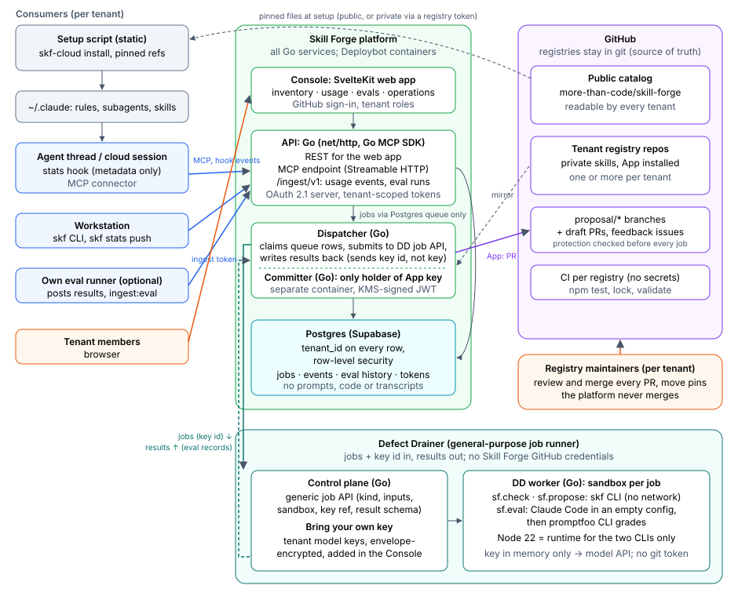

# Skill Forge Console — design

The signed-in web app is called the **Console** (owner, 2026-11-27): tenants see how their consumer
projects use skills, follow evaluations, and run operations from it. The public landing site keeps the name Site.

Status: **approved by the owner (2026-11-27), not built.** Design only (Tier 3: a new
public surface and a new data contract). It extends the approved [MCP server design](MCP.md)
and shares its service, sign-in and stack. Tenancy, the database and the full stack are in
[PLATFORM.md](PLATFORM.md): every page and ingest record below is scoped to one tenant. Decision log: [DESIGN.md](DESIGN.md#key-design-decisions).

## Problem

The owner wants one place to see:

1. **Inventory**: which skills (and instructions, subagents, hooks) exist, at which version,
   with what history, and what is waiting to change.
2. **Usage**: which skills agents actually load, where and how often.
3. **Evaluation**: whether a skill or rule change made agents better or worse, and the history
   of those results.

Today `skf site` renders a static catalog with local stats, but only on the workstation, only
from that machine's hook JSONL, and with no evaluation data (none exists yet: Phases A–C of the
roadmap and the Defect Drainer requirement "Eval: show whether a skill or rule change actually
helps agents" are open).

## Shape

| Choice | Proposal | Why |
|---|---|---|
| Where it runs | The platform's SvelteKit web app, on the same database, sign-in and mirrors as the MCP API ([PLATFORM.md](PLATFORM.md)) | The MCP server already reads registries and records proposals; the Console shows the same data to people |
| Access | Private: GitHub sign-in; members see only their own tenant. The public catalog's inventory is visible to every tenant; a tenant registry's inventory, usage and evals only to that tenant | Tenant registries, usage and evals are private |
| Operations | The Console runs operations, each a server action under the member's role and audited: start eval runs and checks, re-run failed jobs, manage ingest tokens and model keys (bring your own key), members and settings, opt repos in or out of reporting. Registry content still changes only through PRs (MCP `propose_skill`, a workstation, or a proposal started in the Console) | One write path for registry content with one set of checks; operational control in one place |
| Rendering | SvelteKit pages rendered on the server with inline SVG charts (stack in [PLATFORM.md](PLATFORM.md)); `skf site` stays the offline single-user view | Little client code for read-only dashboards |
| Data | Three sources, each with its own schema version: the registry (git), usage events (ingest), eval runs (ingest) | Each source can ship and be judged on its own |

## Pages

| Page | Shows | Source |
|---|---|---|
| Inventory | Every skill, instruction variant, subagent and hook: version, tags, description, last change, usage in the last 30 days, latest eval verdict. Search and tag filter | Registry at `main` and `dev`; usage and eval rollups |
| Skill | `SKILL.md` and companions at a chosen version; version history (from `registry.json` git history, with commit and PR); open proposals and feedback issues; usage over time; eval results per version | Git mirror; proposal records; usage; eval runs |
| Releases | What changed between two refs, the current `main` and `dev`, and which `SKF_REF` each known environment is pinned to (from install reports) | `compare_refs` logic; install reports |
| Usage | Loads per skill per day, by environment kind (workstation, Project thread, cloud session) and repo; skills declared but never loaded; skills loaded together | Usage events |
| Evaluation | Per skill or rule file: pass rate, turns, cost and duration per version, against the previous release; run history with grader output summaries; Layer 1–3 metrics as they ship | Eval runs (later: judge metrics, efficacy ledger) |
| Proposals | Open and recent proposals and feedback issues with their state | MCP proposal records, GitHub |

## Usage data

### What counts as a use

A use is an **observed** event, never an agent's own report (Design principle 4: instructed
self-reporting is unreliable):

| Event | Observed by | Meaning |
|---|---|---|
| `skill.loaded` | The stats hook on `PostToolUse` for the `Skill` tool (new; today the hook records only `Agent`/`Task`) | An agent activated a skill |
| `subagent.spawned` | The stats hook (exists) | An agent delegated to a subagent |
| `session.ended` | The stats hook (exists) | Session boundary, for per-session rollups |
| `env.installed` | `skf-cloud install` (new, one report per install) | Which skills, rules and subagents an environment received, at which `SKF_REF` |
| `mcp.called` | The MCP server itself | Tool name, registry id and skill name only, never free-text inputs such as `query` |

### What is recorded

Metadata only (Design principle 6). Each event carries: schema version, a client-made
`event_id` (UUID), event type, timestamp, artifact name and version, the repo, and the session
id. The server adds tool and environment kind from the token, never from the event. Never
prompt or response text, file contents, paths, task descriptions or user names.

- **Reporting is opt-in per repo.** The stats hook is global and sees every session on a
  machine, so the uploader sends an event only when that repo's `skill-forge.json` has a
  `reporting` block (`{ "tenant": "<id>", "repo": "<owner>/<name>" }`) whose tenant matches the
  token. Everything else stays local and is only counted; `skf stats push --dry-run` shows
  exactly what would leave the machine. The repo name comes from that block, never from `cwd`,
  and the uploader never sends `cwd`, `description` or the folder name.
- **Validation.** `artifact` must match the registry name pattern and is checked against the
  tenant's registries (unknown names go to one `unknown` bucket); `repo` must match
  `owner/name`; timestamps more than 24 hours ahead or 90 days old are rejected; distinct values
  per tenant per day are capped.
- **Pseudonyms.** The server keys session ids with a per-tenant HMAC key and stores only the
  result; deleting the key on tenant deletion makes old pseudonyms unlinkable. A tenant setting
  chooses repo names `plain` (default) or `hashed`; members and viewers see per-repo aggregates,
  only owners see raw event lists.

### How it reaches the Console

| Source | Path | Status |
|---|---|---|
| Workstation | `skf stats push` uploads new local JSONL lines (cursor kept in `~/.skill-forge/stats/.pushed`); run by the owner or by the `SessionEnd` hook in the background | New CLI command |
| Project threads and cloud sessions | The setup script installs the stats hook into `~/.claude` and the hook posts at `SessionEnd` | **Assumption to test first**: that hooks in a setup-script-written `~/.claude/settings.json` run in threads. Rules, skills and agents are tested; hooks are not. If they do not run, threads report only `env.installed` and `mcp.called`, and the Usage page says so |
| `skf-cloud install` | One `env.installed` report per install | Optional (`SKF_REPORT=1`); a failed report never fails setup |
| MCP server | Writes its own `mcp.called` events | — |

Ingest is `POST /ingest/v1/events` on the ingest hostname, a JSON array, authenticated by an
**ingest token**:

- Opaque, `skfi_`-prefixed so secret scanners find it, 256 bits, stored as SHA-256, compared in
  constant time, sent only in an `Authorization` header.
- Bound to one tenant and an environment label fixed at creation (kind and name); the server
  overwrites any `env_kind` or `tool` the client sends.
- Scopes `ingest:events` and `ingest:eval` are separate. Agent environments get only
  `ingest:events`, because an agent can read its own environment and could otherwise post a
  forged "pass"; the eval runner gets `ingest:eval`, and the page labels each eval result with
  the runner that reported it.
- Expires after 180 days by default, shows when it was last used, and is revoked when its
  creator leaves the tenant. On a workstation it lives in `~/.skill-forge/config.json`
  (mode 0600; doctor warns otherwise). It can add records and nothing else.
- Limits: 256 KiB body before authentication, 500 events a batch, per-token and per-tenant
  rates. `(tenant_id, event_id)` is unique and duplicates are ignored, so retries never double
  count.

Raw events are kept 90 days. Daily rollups carry no session or user and are kept until deleted;
deleting a token's or a repo's events also rebuilds the rollups they fed.

## Evaluation results

Evaluations run as `eval` jobs in the platform's runner ([PLATFORM.md](PLATFORM.md#what-the-runner-does)):
a small fixed suite per skill or rule file, seeded tasks, a grader, and pass rate, turns and cost
against the last release, as the Defect Drainer requirement asks. Those results are written
straight into the eval history and marked "platform-run". A tenant can also run suites on its own
machines and post results to `POST /ingest/v1/eval-runs` (scope `ingest:eval`), marked
"runner-reported". One record per task run:

| Field | Meaning |
|---|---|
| `schema` | Eval-run schema version |
| `suite`, `task_id` | The eval set (per skill or rule file) and the seeded task |
| `artifact`, `version` | What is under test, e.g. `skill:coding-discipline@0.3.2` |
| `config` | Configuration fingerprint: registry commit sha and lock hash (Evaluation Model) |
| `baseline` | The version it is compared with (the last release) |
| `runner`, `model` | What ran it (eval tool and version, model id) |
| `verdict` | `pass` / `fail` / `error`, plus grader check results (tests pass, rule followed, no forbidden step) |
| `turns`, `tokens`, `cost_usd`, `duration_ms` | Economics |
| `started_at`, `run_id` | Identity (`run_id` as in the Efficacy ledger) |

No transcript is uploaded; a grader summary of at most 500 bytes is, after the same secret scan
as MCP proposals, stored as plain text and shown escaped. The Evaluation page compares versions only when the suite, task set and
model match, and says when they do not. Judge metrics (Layer 1) and the efficacy ledger (Layer
3) post to the same endpoint under their own record types when they ship.

## Architecture and stack

As in [PLATFORM.md](PLATFORM.md) (SvelteKit web app, Go API, Defect Drainer worker as runner, Postgres), plus:

- Web routes, under a tenant: `/` (inventory), `/skills/<registry>/<name>`, `/releases`,
  `/usage`, `/evals`, `/proposals`, `/settings/tokens`. Ingest lives on the API's ingest
  hostname, not here.
- Postgres tables, each with `tenant_id` under row-level security: `events` (raw, 90 days), `daily_rollups`, `eval_runs`, `ingest_tokens`
  (hashed), plus the MCP server's proposal records.
- Charts: inline SVG rendered on the server, following the repo's existing site styles.

## Contract diff

| Surface | Before | After |
|---|---|---|
| Stats hook | Local JSONL schema 1: `Agent`/`Task`, `SessionEnd` | Schema 2: adds `Skill` tool use and `event_id`; optional background push |
| `skf` CLI | `stats record`, `site` | Adds `stats push` (with `--dry-run`); `skill-forge.json` gains the optional `reporting` block |
| `skf-cloud install` | Writes `~/.claude`, logs locally | Optional `env.installed` report (`SKF_REPORT=1`, ingest token variable); setup never fails on it |
| New public contracts | — | Ingest API `v1` (events and eval runs) and both record schemas, versioned; additive changes only within `v1` |

## Delivery plan (after approval)

Each step its own PR, numbered as in [PLATFORM.md](PLATFORM.md#delivery-plan-after-approval):

1. **Console v0, inventory** (platform step 3): Inventory, Skill (without usage and evals),
   Releases, Proposals. No new data: registry, git history, proposal records.
2. **Console v1, usage** (platform step 5): the `Skill` event in the stats hook, `skf stats push`, the ingest
   endpoint and tokens, the Usage page. Probe hooks in threads first; add the thread path only
   if they run.
3. **Console v2, evaluation** (platform step 7): the Evaluation page, with `eval` jobs in the
   runner and the eval-run ingest.

## Rollback

Turn off the routes (a server flag) and revoke ingest tokens. Hooks and `skf-cloud` keep working
without a Console: a failed push or report is logged and dropped.

## Decided questions

Settled by the owner on 2026-11-27, taking the recommended answers.

1. *Settled by PLATFORM.md*: the Console is the platform's web app, and tenant data is private.
2. *Public catalog pages without sign-in*: useful as a showcase later; not in v0.
3. **Hooks in threads**: run the probe (one Project thread with the stats hook installed by the
   setup script) before building the thread usage path.
4. **Retention**: 90 days raw, rollups kept.
5. **Repo names in usage**: plain by default with a per-tenant `hashed` setting, and only for
   repos that opted in with a `reporting` block.
6. **Eval runner**: first suites and the per-suite budget are in [EVALS.md](EVALS.md); the Console
   only fixes the result schema.
