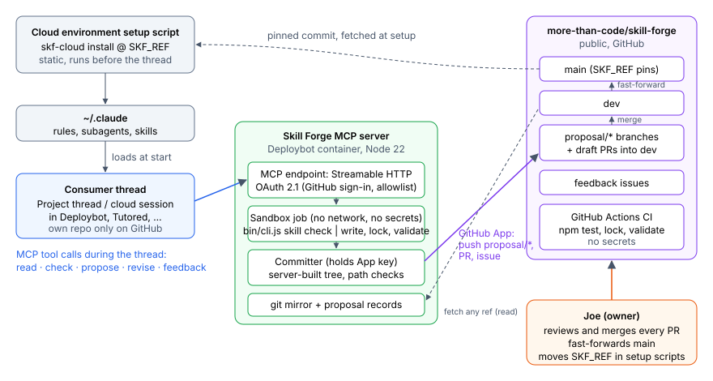

# Skill Forge MCP server — design

> **Multi-tenant revision pending.** The owner asked (2026-11-26) for Skill Forge to be a
> multi-tenant SaaS. The tool surface below stays approved; its single-owner parts (one
> allowlisted account, one App installation, SQLite, one container) are superseded by the
> proposal in [PLATFORM.md](PLATFORM.md), which waits for approval.

Status: **approved design, not built** (owner approval 2026-11-26, PR #4). Each delivery step
below is its own PR; a divergence from this document updates it and is re-approved. Decision log: [DESIGN.md](DESIGN.md#key-design-decisions).
It builds on an earlier draft written in a Defect Drainer thread (nine tools, phased rollout)
and supersedes it.

## Problem

Consumer agents (Claude Project threads in other repositories, cloud sessions, workstation
sessions in consumer repos) learn things a skill should hold, but cannot act on it:

- They have no `skf` CLI. Threads get `bin/skf-cloud.mjs` (install, top-up, doctor) and nothing
  else; `skf skill write` and `skf project add` need a skill-forge checkout and `npm install`.
- Their GitHub access is scoped to their own repositories, so they cannot open a PR on
  skill-forge. Today the only path is "tell the owner, who opens a skill-forge thread".
- Reading the registry means guessing raw GitHub URLs at a ref; checking whether a repo's
  `skill-forge.json` resolves means reimplementing the resolver.

An MCP server gives every consumer one small, typed surface: read the registry, check a skill
against the CLI's own rules, and **propose** a new or changed skill as a pull request into
`dev`. The owner reviews and merges every change; nothing a consumer does changes what any
other thread loads until that merge and a pin move.

Why "propose" and not "create": a consumer never creates a skill. It writes one, the server
checks it, and the effect is a PR. Creating a skill is `propose_skill` with a name the registry
does not have yet.

## Non-goals

- No writes to consumer repositories. The server returns file contents (a manifest, a lock); the
  consumer commits them in its own repo by its own PR (Project rule: each Project changes its
  own repos).
- No merging, no pushes to `dev` or `main`, no release or `SKF_REF` moves.
- No skill deletion, `set-version`, `installable` changes or `bump --update-pins` through the
  server; those stay owner steps on the workstation.
- No proposals for managed instructions (`core.md`, overlays, variants), subagents, hooks or
  `bin/skf-cloud.mjs`. Those are Tier 3 surfaces every thread loads; feedback on them goes
  through `report_feedback`.
- No executable companions in v1: proposals are UTF-8 text and Markdown. A skill that ships
  scripts (`product-parity`, for example) is edited on the workstation.
- Not a replacement for the setup script. It is the static bootstrap that runs before a thread
  starts; this server is called only from inside a running thread (Decision 10).
- Not a replacement for `skf-cloud doctor` or `install --top-up`: those read the thread's own
  disk, which a remote server cannot see. The server may tell an agent to run them.

## Shape

| Choice | Proposal | Why |
|---|---|---|
| Transport | Remote MCP over Streamable HTTP, added once as a claude.ai custom connector | Threads ignore a repo's `.mcp.json`; a connector needs no setup-script change. Same model as the owner's other connectors. **Assumption to test before v0**: a custom connector is available in Project threads and cloud sessions |
| Identity | OAuth 2.1 with scopes `registry:read` and `propose` (see Authentication and authorization) | One account today: propose tools serve only allowlisted account ids. A connector can be granted read only |
| GitHub writes | A GitHub App installed on `more-than-code/skill-forge` only, permissions `contents: write`, `pull_requests: write`, `issues: write`, confined by a ruleset that applies to the App alone | The consumer's own GitHub scope is never used or widened. App permissions are repo-wide, so the ruleset and the server's own checks, not the permissions, confine it |
| Logic | The server runs the real CLI (`skf skill check`, `skf skill write --json`, which runs `lock` + `validate`) in a sandboxed job: CLI code from a sha the server pins and tests against, registry data from `origin/dev`, the agent's files as inert data | One implementation of the rules, also used on the workstation; the server never executes proposed content |
| State | None of its own beyond a small record of the PRs and issues it opened. The agent keeps its working text; the PR is the proposal | No draft store, expiry or quotas to run for a one-owner project |
| Reads | Pinned commit: `ref` is a 40-hex sha, `dev` (the default for authoring) or `main` (the default for pin questions), resolved and echoed back as `ref_sha` with a GitHub URL for that sha | The consumer can verify the sha on GitHub; the server's resolution is a convenience, not a trust root |
| Hosting | One container on the owner's host, deployed by Deploybot | Decision 1; multi-tenant: [PLATFORM.md](PLATFORM.md) |

Server name: **Skill Forge** (tools appear as `mcp__Skill_Forge__<tool>`). Tool names are
`verb_noun` snake case in two families, `skill` and `proposal`, the convention of the owner's
other servers (`list_*`, `get_*`, `whats_new`). Twelve tools in v1, fourteen with v1.1: the connector is
loaded by every Project that enables it, and the steward skill already counts tools per
connector as context cost. It can be turned off per Project.

## Architecture and stack

The setup script is the static path (before a thread starts); the server is the dynamic path
(tool calls inside a running thread). Both read the same repo; only the server writes, and only
`proposal/*` branches, PRs and issues.

| Layer | Choice | Notes |
|---|---|---|
| Runtime | Node 22 LTS, plain ESM JavaScript like `bin/` | No build step; the server imports the CLI's modules and spawns `bin/cli.js` for writes |
| MCP | Official `@modelcontextprotocol/sdk`, Streamable HTTP transport, stateless requests | New dependencies: the SDK and its `zod` peer, pinned |
| Auth | The server is its own OAuth 2.1 authorization server (MCP authorization spec: PKCE, dynamic client registration for claude.ai), with sign-in delegated to GitHub OAuth; the allowlist holds GitHub user ids | No separate identity provider to run |
| GitHub | REST over `fetch`; the App's JWT is signed with `node:crypto` (RS256) and exchanged for a short-lived installation token per propose job | No Octokit |
| Git | `git` CLI with a bare mirror refreshed by `fetch`; checkouts are throwaway worktrees | |
| Sandbox | `bubblewrap` inside the container: no network, no secrets, read-only binds, a tmpfs work dir, CPU, memory and time limits | Needs user namespaces in the Deploybot entry, to confirm in v1. Never the container runtime's socket |
| State | SQLite through the built-in `node:sqlite`, on a volume | Only records of opened PRs and issues, and rate-limit counters. Superseded by Postgres in [PLATFORM.md](PLATFORM.md) |
| Hosting | `server/Dockerfile` image, deployed as a Deploybot catalog entry with an HTTPS route; secrets (App key, OAuth client secret) as a Deploybot env set | |
| CI | GitHub Actions: `npm ci --ignore-scripts`, `npm test`, `lock`, `validate`, `permissions: contents: read`, no secrets; server tests run against a fixture registry | Decision 6 |

## Tools

Permission column: **read** changes nothing; **propose** creates or changes a `proposal/*`
branch, PR or feedback issue on skill-forge.

### Discover (v0)

| Tool | Permission | Nearest CLI | Inputs | Output |
|---|---|---|---|---|
| `whats_new` | read | — | — | `{ server_version, contract_version, changes: [{ date, tool, change }] }` |
| `list_skills` | read | `skf skill list [--all] --json` (a bare array) | `query?` (name, description, tags), `tags?`, `include_tracked?` (= `--all`, default false), `ref?` | `{ ref_sha, skills: [{ name, version, description, tags, installable }] }`; `custom` scope only |
| `get_skill` | read | `skf skill read --json` (`body` + `companions`) | `name`, `files?` (default `["SKILL.md"]`; a list of paths or `"all"`), `ref?` | `{ ref_sha, name, version, tags, installable, listing: [{ path, bytes }], files: { path: text }, truncated: [path] }` |
| `compare_refs` | read | doctor's "SKF_REF behind" check plus a manual diff | `from` (a sha, e.g. a Project's `SKF_REF`), `to?` (default `main`) | `{ from, to_sha, skills: [{ name, change, from_version, to_version }], instructions_changed, subagents_changed, cloud_script_changed, unreleased_on_dev: [skill], setup_line }` |
| `get_authoring_guide` | read | the `skill-forge-authoring` skill | — | The authoring doctrine as text (see Downstream docs) |
| `report_feedback` | propose | — | `artifact` (must name a registry artifact: `skill:<name>`, `instructions:<variant>`, `subagent:<tool>/<name>`, `skf-cloud`), `kind` (`wrong`/`missing`/`conflict`/`noise`), `body`, `evidence?` (capped) | `{ issue_url }`: one issue labelled `feedback` and `artifact:<…>` |

`compare_refs` answers "do we need a pin move, and what would it change", which today needs
`git ls-remote` (often blocked) plus a manual diff. `unreleased_on_dev` lists merged changes
still waiting for the release to `main`. `setup_line` is the drafted `SKF_REF=<full sha>` line.
`report_feedback` is in v0 because it needs only `issues: write` and is the cheapest way to feed
the Evolve loop.

### Author and follow (v1)

| Tool | Permission | Nearest CLI | Inputs | Output |
|---|---|---|---|---|
| `check_skill` | read | `skf skill check --json` (new, Delivery step 0) | `name`, and either `files` (path → text; `SKILL.md` required for a new skill) or `edits` (`[{ path, old, new }]` against the skill at `base_sha`, cheaper for a small change), `base_sha?` (the `ref_sha` the agent read; omitted means new) | `check` (below) |
| `propose_skill` | propose | `skf skill write` (+ `bump --patch`) on a branch, then a PR | as `check_skill`, plus `rationale`, `source` (consumer repo and thread link, kept private), `bump?`, `title?` | `{ proposal_id, pr_url, branch, version, check }` |
| `list_proposals` | read | — | `state?` (`open`/`merged`/`closed`), `skill?` | `[{ proposal_id, skill, pr_url, state, checks, review_state, updated_at }]` |
| `get_proposal` | read | — | `proposal_id` | State, checks, the owner's review comments as `untrusted_text`, and whether `dev` has moved past the base |
| `revise_proposal` | propose | — | `proposal_id`, `files` or `edits`, `rationale?` | The branch rebuilt from current `dev`; same `check` |
| `withdraw_proposal` | propose | — | `proposal_id`, `reason` | Closes the PR and deletes its branch, keeping the branch when it holds commits the App did not write |

`proposal_id` is the PR number; a hidden marker in the PR body ties it to the server's record.

`check` is deterministic and identical on the workstation (`skf skill check`):

- `errors` (block `propose_skill`): name pattern and safe companion paths (enforced today inside
  `skill write`), frontmatter `name`/`description`, `version` in frontmatter, absolute home
  paths and the skill's own vendor path (`validate`), secret patterns, files over the size cap,
  executable companions, and a new skill whose name already exists at `dev`.
- `warnings` (shown on the PR): a description over the budget (a number defined in the CLI) or
  without an activation clause; a name or description close to an existing skill, with the match
  (propose an edit instead of a duplicate); repo names, host names, ports or ids that look like
  runtime data (authoring rule 9, heuristic); a body large enough to belong in a companion;
  invisible or bidirectional Unicode, HTML comments, large encoded blobs, links to hosts outside
  an allowlist, and instructions to fetch and run code or read credential files.
- `suggestions`: names that pass when the requested one is taken or invalid, and the bump.

The server does not rewrite prose. "Help name or polish" means `get_authoring_guide`, the
checks above, and suggested names: the agent writes, the server says precisely what fails.

**Versions.** Nearly every registry skill is below 1.0, and consumers declare caret ranges such
as `^0.3.1`, which a 0.x minor or major bump no longer satisfies: `skf-cloud install` then skips
the skill. So `propose_skill` accepts only `patch` for a 0.x skill and `patch` or `minor` from
1.0; a new skill starts at `0.1.0`. A change that needs more is proposed as a patch and labelled
`needs-owner-decision`, with the PR body saying which ranges it would strand. The server cannot
see consumer manifests, so it cannot list the repos; the owner bumps and moves pins.

**What `propose_skill` does**, in order:

1. Refuse when `check.errors` is non-empty; when a new skill's name now exists on `dev`; when
   an edit's skill tree on `dev` differs from `base_sha`'s (re-read and retry); or when an open
   proposal for the same skill exists (return that `proposal_id`: one open proposal per skill,
   so a retry is idempotent).
2. In a sandboxed job, apply the change to a checkout of `origin/dev`: the server diffs the
   files against the base tree and passes `--file` and `--remove-file` itself (`skill write`
   never removes a companion that is merely absent). A new skill is one
   `skill write <name> --set-version 0.1.0 --json`; an edit is `skill write` then
   `skill bump --patch` (never `--update-pins`). Both run `lock` + `validate`. A `validate`
   failure in a file outside the proposed skill is reported as a server error, not blamed on
   the consumer. The server does not run `npm test`, which executes every test file it finds.
3. Check the job's output (Permissions and safety), then build the commit itself on a new
   branch `proposal/<skill>-<random id>` as the App. The commit carries a `Proposal-Id:`
   trailer, never a consumer repo name or thread link.
4. Open a **draft** PR into `dev`, assigned to the owner, review requested. The server builds
   the body from the diff: changed files and sizes, `check` warnings, the gate table (`npm
   test` listed as `not run` until the CI workflow exists, Decision 6), and "After merge"
   notes: run `skf sync` in skill-forge so its own `skill-forge.lock.json` follows; a pin move
   is needed for Projects; consumers that declare the skill pick it up on their next sync or
   top-up. The agent's `rationale` and `title` appear only under "Agent-provided rationale",
   after the secret scan, with `@mentions`, issue references and closing keywords neutralised.

The owner marks it ready, asks for changes (read with `get_proposal`, answered with
`revise_proposal`), merges or closes. `revise_proposal`, and any refresh after `dev` moved,
rebuilds the branch from current `dev` by re-running the job and force-pushes with lease to the
proposal's own branch: the generated `registry.json` and lock are regenerated, so a rebuilt
branch cannot conflict with another merged proposal.

### Consumer profile (v1.1)

| Tool | Permission | Nearest CLI | Inputs | Output |
|---|---|---|---|---|
| `check_profile` | read | the resolution half of `skf sync --check` | `manifest`, `lock?`, `ref?` | `{ ref_sha, findings: [{ severity, skill?, code, message, fix }] }` |
| `prepare_profile_change` | read | `skf project add` + `skf sync` (manifest and lock only) | `manifest`, `lock?`, `add: [name]`, `ref?` | `{ ref_sha, files: { "skill-forge.json": text, "skill-forge.lock.json": text or null }, summary }` |

Both need the profile resolver from `bin/cli.js` as an importable module (Delivery step 0).

- `check_profile` reports unknown names, ranges no version at `ref` satisfies, a below-1.0
  caret that will not reach the next minor, and a variant missing its shim. It compares only
  `skills.<name>.{version,integrity}` for registry skills; a `lockIntegrity` difference is a
  note (it changes whenever any skill changes), and `skills.local` entries are not checked
  (their hashes cover directories the server never sees).
- `prepare_profile_change` adds `^<version at ref>` like `project add`, and refuses a name in
  `skills.local` likewise. It returns a lock equal to what `sync` writes under `sync --check`'s
  comparison (`registry.commit` excluded) only when the repo has no `skills.local`, no
  `instructions` and `"generated": "ignored"`. Otherwise it returns the manifest with `lock:
  null` and the fix "run `skf sync` on a workstation", because `sync` also writes vendored
  copies, the `.gitignore` block and instruction blocks. The consumer commits by its own PR,
  then runs `skf-cloud install --top-up` to use the skill in the current thread.

## Authentication and authorization

- OAuth 2.1 with PKCE, exact redirect URI matching for the claude.ai callback, short-lived
  access tokens bound to this server's audience (a token minted for another of the owner's
  connectors is refused), TLS only, and an `Origin` check on the HTTP endpoint.
- Every call validates the token (issuer, audience, expiry, scope) and keys the caller on the
  immutable account id, never an email or login. Propose tools serve only account ids in the
  server's allowlist.
- Every proposal and feedback record carries `owner_id`; every operation on a `proposal_id`
  checks it and answers a uniform "not found" on mismatch. A PR the server did not open is
  refused.
- Tools carry MCP annotations (`readOnlyHint` on reads; `destructiveHint` on
  `withdraw_proposal`), so clients that ask per tool give the person a consent point on every
  write. This matters because the connector is account wide: a thread that has read
  prompt-injected content can call it too.

## Permissions and safety

| Surface | Read | Write |
|---|---|---|
| Registry, inventory, lock at any ref | any caller with `registry:read` | never |
| skill-forge branches | — | only `proposal/*` branches the server created |
| skill-forge paths in a proposal | — | only `inventory/skills/<name>/**`, that skill's row in `registry.json` and its entries in `registry-lock.json` |
| skill-forge PRs and issues | the owner's and the App's text on proposals the server opened | open, comment on, close its own, checked against its own record (GitHub permissions cannot express "its own"); never merge, approve or mark ready |
| Consumer repositories | the agent passes file text in | never |

Trust boundaries, in order: the caller (an allowlisted account, but possibly a thread that read
prompt-injected text) → the server (holds the App key, never runs proposed content) → the
sandbox job (no secrets, inert data) → the committer (server-built tree) → GitHub (ruleset) →
the owner's review and merge.

- **The ruleset is a precondition** for every propose tool. It applies to the App only, so the
  owner's own PR flow is unchanged: the App may create and push only `proposal/*` branches,
  cannot push to `dev`, `main` or any other branch, and is never a bypass actor.
- **The sandbox job** runs as a non-root user in a fresh temporary directory deleted afterwards,
  with no network, CPU, memory and a 120-second time limit, a cleared environment (`PATH`, and
  `HOME` set to an empty directory so the CLI's `$HOME` profile lookup finds nothing), and no
  App key, token or OAuth secret present. The CLI is spawned with an argument array and `--`
  separators, never a shell. Its dependencies (`commander`, `chalk`, `fs-extra`, `inquirer`) are
  installed at image build time with `npm ci --ignore-scripts`, never at job time.
- **The committer** takes from the job only an explicit list of (path, bytes), forces mode
  100644, and rejects symlinks, submodules, non-regular files, `.git` or `..` segments, and
  paths that collide after case folding or Unicode normalisation. Proposed files may not match
  `*.test.*`, `test/**`, `package.json` or `.github/**`, even inside a skill directory. In
  `registry.json` only the named skill's `version` and `tags` may change (a new skill's row gets
  fixed `scope`, `installable` and `path`); the rest must be byte-identical to `dev`. In
  `registry-lock.json` only that skill's entries may change. Any other change aborts.
- **Skill text is future instructions.** A merged skill is vendored into repos and threads the
  author never sees, so every proposal is a draft PR that needs the owner's review of the diff
  the server describes, not the agent's summary. `get_proposal` returns comments only from the
  owner and the App, by account id, as a typed `untrusted_text` field with control and
  zero-width characters stripped; other comments are counted, not returned.
- **The registry is public.** Everything in a proposal PR or feedback issue is public. `source`
  stays in the server's record and is never written to GitHub; the PR shows the proposal id.
  Secret patterns in any agent-supplied string (files, `rationale`, `title`, `reason`, feedback
  `body` and `evidence`) are errors.
- **Inputs are bounded.** File count and size caps (Decision 3); caller-supplied
  `manifest` and `lock` text too. Companion paths go through the same safe-relative-path rule as
  `skf-cloud`; skill names through the registry pattern. A `ref` is resolved against the
  server's own mirror, never passed to git as given.
- **Logs** take only enumerated fields (tool, skill name, proposal id, outcome), never file
  contents; the CLI's JSON reaches the caller through a field allowlist (code, message, path
  relative to the skill directory), so server paths and traces never leak.
- **Limits**, for one owner: 10 open proposals in total and one propose job at a time.

## Contract and versioning

**Before → after.** Before: no server; consumers read raw files at a sha and ask the owner for
changes. After, new public surfaces:

1. The tool names, inputs and outputs above, versioned by an integer `contract_version` in
   `whats_new` and in each output's `meta`.
2. The CLI's `--json` output and exit codes for `skill list|read|check|write|bump`, `lock` and
   `validate`, which the server consumes. AGENTS.md "Change Workflow" gains a line saying so.
3. The PR body marker and `proposal/*` branch naming.

Rules: additive changes only within a `contract_version` (new optional input, new output field,
new tool); `whats_new` lists them with dates. A breaking change gets a new tool name, and the old
one stays, deprecated in `whats_new`, for 90 days or one `contract_version`, whichever is
longer. Output enums (`change`, `severity`, `code`, `state`) may gain values; consumers treat
unknown values as "other". The server pins the CLI sha it runs and its CI tests against that
sha and against `dev`.

## Alternatives considered

| Alternative | Why not |
|---|---|
| Give threads GitHub write scope on skill-forge | Every thread's agent could push anywhere in the repo; no shared checks |
| Ship the `skf` CLI to threads (`npx`) | Solves reads and checks, not writes: threads still cannot open a PR on skill-forge |
| Fork-based PRs from the App | Same review, more moving parts; the ruleset confines a same-repo branch as well |
| Feedback issues only | Cheapest, and kept as `report_feedback`, but every fix still waits for the owner to write it |

## Rollback

Turn the connector off in claude.ai and uninstall the App. Open proposal PRs stay as ordinary
PRs the owner can close; nothing in consumer repos or Projects depends on the server.

## Delivery plan (after approval)

- **Now, no code**: consumer threads file skill requests and feedback as Defect Drainer items
  in the Skill Forge project, with the proposed text in the item, and a thread here writes the
  PR. This works today and is the fallback while the server is built.

0. **CLI, Tier 2**: extract the profile resolver as an importable module with tests (`bin/cli.js`
   and `skf-cloud` keep their own copies until then); add the read-only
   `skf skill check <name> --json` with the checks above and a defined description budget.
1. **v0, read-only plus feedback**: `whats_new`, `list_skills`, `get_skill`, `compare_refs`,
   `get_authoring_guide`, `report_feedback`. Test the connector-in-threads assumption first.
2. **v1, authoring**: the App, its ruleset and the CI workflow first, then `check_skill`, `propose_skill`,
   `list_proposals`, `get_proposal`, `revise_proposal`, `withdraw_proposal`.
3. **v1.1, profiles**: `check_profile`, `prepare_profile_change`.

Each step is its own PR with its spec and tests against a fixture registry.

## Downstream docs

Updated in the step that ships each tool: AGENTS.md (the CLI JSON contract line), README,
DESIGN.md, `claude-project-steward` (point threads at the tools), and `skill-forge-authoring`:
its doctrine (name pattern, frontmatter, versions in the registry, no absolute or self-vendor
paths, doctrine not runtime data, activating descriptions) moves into one companion file that
`get_authoring_guide` serves, and rule 7 becomes "shell the CLI when you have a skill-forge
checkout; without one, use the Skill Forge MCP server".

## Decisions (2026-11-26)

The owner approved the design without answering these individually, so the proposed answers
stand. Any of them can be reopened in the PR of the step it affects.

1. **Hosting**: one container on the owner's host, deployed by Deploybot. It needs a git
   mirror, Node, a sandbox and outbound GitHub access.
2. **Code location**: a `server/` folder in this repo, so it shares `bin/cli.js` and is tested
   with it.
3. **Size caps**: 64 KiB per file and 512 KiB or 40 files per proposal. Measured 2026-11-26:
   the largest file is 50 KB (`grok-build-harness/SKILL.md`), the largest skill 288 KB in 20
   files (`product-parity`).
4. **Who may propose**: only the owner's account; members of a Project are a later decision.
   Reopened by the multi-tenant proposal: members of a tenant ([PLATFORM.md](PLATFORM.md)).
5. **Repo-local skills**: v1.1 adds `promote_local_skill` (a consumer's `skills.local` skill
   proposed into the registry, then the manifest change that swaps it for the registry one),
   built on `propose_skill`.
6. **Tests for proposals**: add a GitHub Actions workflow without secrets that runs `lock`,
   `validate` and `npm test` on PRs, in v1 before the propose tools. The server still never runs
   `npm test` itself.
7. **Feedback**: `report_feedback` opens a GitHub issue on skill-forge (public, next to the PRs
   it leads to, needs only the App), not a Defect Drainer item.
8. **No local `skf mcp`** for now: where a checkout exists the CLI is enough. Revisit if
   workstation agents keep guessing flags.
9. **Executable companions** stay out of v1; allowing them later behind a `contains-code`
   label and the CI workflow is a separate decision.
10. **Static bootstrap vs dynamic use** (owner, 2026-11-26): the setup script stays the one
    way a thread gets its rules, subagents and skills, because it runs before the thread starts
    and a connector is only callable after. The server is for dynamic use inside a running
    thread: reading a skill it did not get, checking, proposing and revising skills on the fly,
    and feedback. No tool installs into `~/.claude` or replaces `skf-cloud install`.
