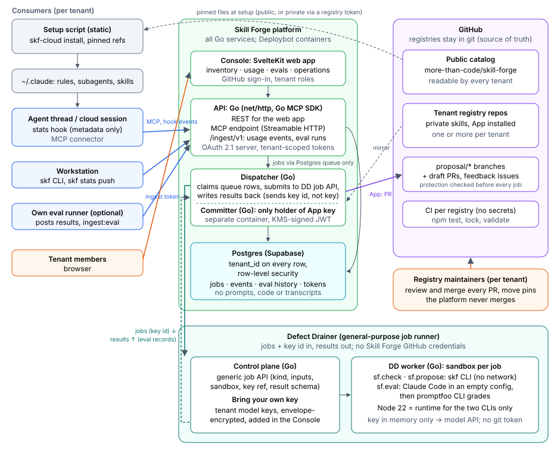

# Skill Forge platform — multi-tenant design

Status: **approved by the owner (2026-11-27), not built.** Design only (Tier 3). It
changes the deployment, identity and data parts of the [MCP server](MCP.md) and the
[console](CONSOLE.md) from one owner to many tenants. The MCP tool surface in MCP.md stays as
approved; the sections of MCP.md this document replaces are listed under "Supersedes in
MCP.md", and nothing else in MCP.md changes.

## What changes

Skill Forge becomes a hosted service that organisations sign up to: browse a shared public
catalog, keep their own private skills, give their agents the MCP tools, and see their own
usage and evaluation data. Three design principles carry over and shape the tenancy model:

- **A tenant's registry is a git repository it owns.** Versions, locks and review stay in git;
  the platform indexes and serves it, never replaces it (Design principle 1).
- **Every change is a PR that the tenant's reviewers merge on GitHub.** "Only Joe merges"
  becomes "only the people the registry's branch protection allows". The platform checks that
  protection exists before it proposes anything (below), and never merges or approves.
- **Telemetry is metadata only.** Usage and eval records never hold prompts, code or
  transcripts (principle 6). What the platform does store is listed under Privacy.

## Tenancy model

| Concept | Meaning |
|---|---|
| Tenant | A GitHub organisation or personal account, identified by its immutable GitHub account id. Owns members, registries, tokens, usage and eval data |
| Member | A signed-in user with a platform role in a tenant: `owner` (members, tokens, settings, deletion), `member` (reads, proposes, sees usage and evals), `viewer` (reads only). Merge rights are not a platform role: the Console shows "can merge" read-only from GitHub per registry |
| Registry | A git repo with `registry.json`, `inventory/` and `registry-lock.json`, connected by installing the platform's GitHub App on it. A tenant can have several; one is its primary |
| Public catalog | `more-than-code/skill-forge`, readable by every tenant |
| Consumer | An agent environment (workstation, Project thread, cloud session) that installs from registries and holds tenant-scoped tokens |

**Creating a tenant and connecting a registry.** A tenant exists only for a GitHub account the
signed-in user controls: a personal account, or an organisation where the user is an owner. A
registry is connected only through the App's `installation` webhook together with a signed-in
user whose user-to-server token lists that installation (`GET /user/installations`); the setup
callback carries a one-time `state` bound to the session. The installation account's id (never
its login) is stored on the tenant, and a repository id belongs to at most one tenant
(`UNIQUE(github_repo_id)`). This closes the setup-callback confused deputy (passing someone
else's `installation_id`) and name squatting.

**Membership** is re-checked on GitHub `organization`, `membership` and `installation` webhooks
and at every token refresh. A person who leaves the organisation loses platform membership, and
the MCP, ingest and registry tokens they created are revoked.

**Names across registries.** Wherever more than one registry is configured, skills are addressed
as `<registry>/<name>`. An unqualified name resolves only in the tenant's primary registry. A
name present in two configured registries is an error at `skf sync` and `check_profile`, naming
both, and never a silent shadow at runtime; public pins move only when the tenant moves them, so
a new public skill cannot break a tenant until it chooses to update. Clash checks for proposals
compare only against the caller's own registries and the public catalog; no tool ever reveals
whether a name exists in another tenant's registry.

**Proposals.** `registry` is a required input of `propose_skill`, `revise_proposal` and
`report_feedback` (no default, so a write never lands in the public catalog by omission).

- Into a tenant registry: the PR opens there and the tenant's protection decides.
- Into the public catalog: an explicit `registry: "public"`, a per-tenant cap (3 open, 10 a
  day), a warning that the text becomes public, and a refusal to copy content from a private
  registry's skill unless the caller restates it. Its maintainers review it like any outside PR.
- `proposal_id` is opaque (`<registry_id>:<pr_number>`), and "one open proposal per skill" is
  per tenant and registry.

**Branch protection is checked, not assumed.** Propose tools stay disabled for a registry until
the platform (App permission `administration: read`) has read its rulesets and branch protection
and found the default branch and `dev` protected from the App: PRs required, at least one human
approval, the App not a bypass actor or allowed approver. The check re-runs before every job and
on `repository_ruleset` and `installation` webhooks; a failure turns the registry read-only. The
tenant does the setup from a documented checklist.

## Isolation

- **Database roles.** `app_migrator` owns the tables and is never used at runtime. `app_web`,
  `app_api` and `app_worker` are non-owner roles without `BYPASSRLS`. Every tenant table has
  `ENABLE` and `FORCE ROW LEVEL SECURITY` and the policy
  `tenant_id = current_setting('app.tenant_id')::uuid`. The tenant is set with `SET LOCAL` inside
  each request or job transaction, never per session, because the connection pooler runs in
  transaction mode. The tenant comes from the verified session or token, never from input.
- **Non-tenant tables** are an explicit list: `users`, `tenants`, `installations`,
  `oauth_clients`, `jobs`. `jobs` holds only claim columns (id, tenant, kind, state); the payload
  sits in a tenant table that the worker reads under that job's tenant. Rollups and retention run
  one transaction per tenant. CI fails when a table is neither on the list nor under FORCE RLS
  with a policy.
- **Supabase specifics.** Used as Postgres only: the Data API (PostgREST) is disabled, the app
  schema is not exposed, and the `service_role` key is never deployed.
- **Two worker components.** The *runner* (a Defect Drainer worker) executes propose jobs in the sandbox and refreshes
  mirrors; it has no GitHub credentials and reads only its job. The *committer* is a separate Go
  container that takes the runner's (path, bytes) list, applies MCP.md's commit checks, and
  alone holds the App key, preferably as a KMS signing key so it never sits in process memory.
  Mirrors are mounted into the sandbox read-only, one registry at a time.
- **Tokens.** Every token (MCP, API, ingest, registry) is bound to one tenant and its scopes.
  App installation tokens are minted per job for one registry only.
- **Caches** are keyed by `(tenant_id, registry_id, sha)`, except content-addressed public
  catalog entries. Authenticated pages and registry-token responses send
  `Cache-Control: private, no-store`.
- **Webhooks** arrive on one endpoint, checked by `X-Hub-Signature-256` and de-duplicated by
  delivery id. They trigger mirror refreshes, membership and installation changes, and the
  branch protection check.
- **Fairness.** From the first release: one running and five queued jobs per tenant, an open
  proposal cap per tenant, mirror size (500 MB) and fetch time caps, job payload caps.
- **Audit.** An append-only `audit_events` table per tenant (actor, action, target, time, hashed
  IP) for token, member, registry, proposal, export and delete actions, visible to owners.

## MCP tokens for people in several tenants

A claude.ai connector is added once per account, so an MCP token is minted for exactly one
tenant, chosen on the consent screen and shown in `whats_new` and every result's `meta.tenant`.
A `registry` outside that tenant answers "not found". A person in two tenants adds the connector
twice. Dynamic client registration is rate-limited; redirect URIs must be exact https callbacks
from an allowlist or RFC 8252 loopback; registered clients unused for 30 days are pruned.

## Full stack

| Layer | Recommendation | Alternatives | Why |
|---|---|---|---|
| Web app | SvelteKit (Svelte 5, runes), server-side rendering, with its own server routes for the Console's reads | React/Next.js | The owner's front ends use Svelte; the repo already carries the Svelte guidance |
| API | **Go** (current stable release), standard `net/http` routing: the MCP endpoint with the official Go MCP SDK (`github.com/modelcontextprotocol/go-sdk`, v1, Streamable HTTP; pinned at implementation), the OAuth endpoints, webhooks and ingest. Database access with `pgx` and `sqlc`. Ingest is served on its own hostname (`ingest.<domain>`) that never reads cookies and has its own rate-limit pool | TypeScript on Node for everything | Owner's choice (2026-11-26): Go for the request-serving path (performance, one static binary, plain code that agents write and review well); Node only where its ecosystem matters, in the worker. Ingest on its own host keeps machine traffic away from sign-in and pages |
| Runner | **The Defect Drainer worker** (`dd-worker`, Go), extended into a general-purpose sandboxed job runner with bring-your-own-key as drafted in [DD-WORKER-JOBS.md](DD-WORKER-JOBS.md) and filed in Defect Drainer as `DEF-20261126-worker-general-purpose-job-runner-with-b-o0er`. Skill Forge's jobs are kinds on it: `sf.check`, `sf.propose`, `sf.eval`. A small Go **dispatcher** in the API codebase claims rows from the Postgres job queue, submits them to DD's job API and writes results back. **Skill Forge writes no Node code**: the Go worker starts the `skf` CLI (`node bin/cli.js … --json`) and Promptfoo (`promptfoo eval -c <config> -o results.json`) as standalone processes inside job sandboxes, so Node 22 is only a runtime in the job sandbox image. Agent SDK use, if needed later, goes through Promptfoo's providers or is deferred. Holds no Skill Forge GitHub credentials | Skill Forge's own Node worker (TypeScript, pg-boss), as proposed earlier on 2026-11-26 | Owner's choice (2026-11-26): the whole platform is Go (API, MCP, dispatcher, committer, and the DD worker's orchestration); the DD worker already is a sandboxed runner with an agent integration (per-job empty Claude config, bwrap sandbox, caps, cost capture, secret redaction); one runner to harden instead of two. Skill Forge's own worker stays the fallback if the DD changes slip |
| Committer | **Go**, a separate small container from the API codebase; the only holder of the GitHub App key (KMS-signed JWT). Takes a finished `propose` job's (path, bytes) list from the queue, re-checks paths and fields, builds the tree and pushes | Committer in the Node worker codebase | Keeps the key out of the Node image and its large npm dependency tree (Agent SDK, AI SDK, Promptfoo), where supply-chain risk concentrates; the committer's own code is small and has few dependencies |
| Database | **Postgres** with row-level security | SQLite | Several services and tenants, RLS, managed backups |
| Postgres host | **Supabase**, as Postgres only (see Isolation) | Postgres on a Deploybot host | Backups and point-in-time recovery are not ours to run; using it as plain Postgres keeps a move easy |
| OAuth for MCP | Decided in the foundation spec against a requirement list (PKCE S256, audience-bound tokens with a tenant claim, limited dynamic client registration, refresh rotation, revocation). Default: a maintained library or provider; a hand-built authorization server only with its own security review | — | It is the most security-sensitive component |
| People's sign-in | GitHub OAuth; HttpOnly, Secure, SameSite=Lax session cookies; CSRF tokens on forms | Email, Google | Tenants are GitHub accounts |
| GitHub | One public GitHub App, installed per registry repo | One App per tenant | The GitHub-native multi-tenant pattern |
| Hosting | Containers on Deploybot hosts, HTTPS routes, secrets in Deploybot env sets; Supabase in one region | A PaaS | Existing deploy tooling. Single region at first; RPO 24 h and RTO 4 h as starting targets |
| CI | GitHub Actions: `go vet`, `golangci-lint`, `go test` for the API and committer; lint, `tsc` and `npm test` for the worker, the web app and the CLI; integration tests against a disposable Postgres, including the job-queue contract between Go and Node; an RLS test per table, a cross-tenant access matrix, ingest abuse tests | — | Isolation is tested, not assumed |
| Observability | OTel to a collector, with ids only in spans (no tenant names, skill names or repo names) | — | Telemetry must not become a second copy of tenant data |

The Go API and the runner meet **only through the Postgres job queue**: the API inserts a job row (type, tenant, registry, inputs) and reads its result row; the Go dispatcher is the only component that talks to Defect Drainer, and the job and result schemas are a versioned contract tested from both sides. Rule logic is never ported to Go: anything that checks, resolves, locks or validates runs the `skf` CLI inside a runner sandbox, so there is one implementation of the rules. The Go services only parse the registry's plain data files (`registry.json`, the lock, skill files) for reads. The sandbox split is unchanged: code that executes registry content, a proposal or an agent runs only inside a runner sandbox; runner jobs get no GitHub token (`git: none`); Skill Forge's Go committer is the only holder of its App key. Tenancy on the runner (tenant-owned workers first, per-job microVMs before open sign-up) is in DD-WORKER-JOBS.md. Evaluation in detail: [EVALS.md](EVALS.md).

## Consumers across tenants

- **Private registries in `skf-cloud`.** Today the commit sha authenticates everything because
  the files come straight from GitHub. Two options, in order of preference:
  1. The tenant gives the setup script a fine-grained, read-only GitHub token for its registry
     repo, and `skf-cloud` fetches from GitHub as today: the same trust model, no platform in the
     bootstrap path.
  2. The platform serves the files with a **registry token** and a manifest signed by the
     platform (ed25519, public key pinned in the declaration as `SKF_REGISTRY_KEY`) that binds
     registry id, commit sha and the lock's sha256; `skf-cloud` checks the signature, then the
     lock, then every file. This trusts the platform and is documented as weaker.
  In both, a registry that cannot be reached is a failed install and a doctor error, never a
  silent skip.
- **Where a token may be sent.** A registry token is bound to one host and one registry.
  `skf-cloud` sends it only to a host named in the setup script's own declaration
  (`SKF_REGISTRY_<NAME>_URL`), only over https, in an `Authorization` header, and redacts it
  from `skf-setup.log`. A `registries` entry in a repo's `skill-forge.json` without a matching
  setup declaration is skipped and reported by doctor; a manifest can never redirect a token.
- **`skf` CLI** gains `registries` in `skill-forge.json` (the public catalog by default) and
  qualified names.

Each of these is a change to a public contract (`skf-cloud` declaration, `state.json`, doctor
JSON with a `version` bump, the manifest schema) and gets its own spec before code.

## What the runner does

The runner (a Defect Drainer worker, see Full stack) is the platform's isolated job machine. Everything that executes registry content or
an agent goes through it, never through the web app or API. It runs three kinds of job, each in
a fresh sandbox, one registry at a time:

| Job | Does | Network | Secrets | Output |
|---|---|---|---|---|
| `check` | `skf skill check` and `validate` on a skill or a proposal (MCP `check_skill`, console checks, pre-merge checks) | none | none | Findings |
| `propose` | `skill write`, `bump`, `lock`, `validate` on a proposal | none | none | (path, bytes) list for the committer |
| `eval` | Runs a skill's eval suite: seeded tasks, an agent with the skill installed, a grader | the model API only, through an egress allowlist | the tenant's model API key, for that job only | Eval runs into the Console's eval history |

**Evaluation jobs** answer the Defect Drainer requirement "Eval: show whether a skill or rule
change actually helps agents":

- **Suites live in the registry**, next to what they test, as `evals/<artifact>/suite.json` with
  seeded tasks (a fixture repo or files, a prompt, a budget) and a grader (tests that must pass,
  rules that must be followed, steps that must not happen). They are versioned and reviewed like
  skills. The format is its own spec. The framework is **Promptfoo** (owner's decision,
  2026-11-26): Node and TypeScript, open source, runs headless, with providers for Claude and the
  Agent SDK and custom graders. It runs inside the `eval` job. The spec also checks `claude plugin eval` and the skill-doctor report so we reuse rather
  than rebuild, and keeps our own `suite.json` and `eval_runs` record so the framework can be
  swapped.
- **A run** installs the artifact at the version under test into an empty Claude configuration
  inside the sandbox, runs each task headless (Claude Code or the Agent SDK) with a turn, token,
  time and cost cap, grades it, and records pass or fail, turns, tokens, cost and duration. The
  same tasks run against the baseline (the last release), so every result is a comparison.
- **Triggers**: on demand from the Console; on a proposal PR, comparing the proposal with its
  base and posting the result to the PR; and before a release. Each trigger checks the tenant's
  eval budget first.
- **Isolation**: no GitHub key or token in an eval job (the committer never runs evals); egress
  only to the model API host; the API key is the tenant's own (bring your own key, stored
  encrypted, injected into that job only, never logged); transcripts stay inside the sandbox and
  are discarded, and only the record and a grader summary of at most 500 bytes leave it.
- **Results** are written straight into `eval_runs` under the tenant and marked
  "platform-run", with the suite, task set, model and configuration fingerprint, so the Console
  compares only like with like. Results posted through the ingest API stay possible and are
  marked "runner-reported".

## Privacy

Usage and eval telemetry contain no prompts, code or transcripts. For a tenant, the platform does
store: mirrors of its connected registries; proposal and feedback text while a proposal is open;
grader summaries (at most 500 bytes, secret-scanned, shown escaped); usage and eval records as
described in CONSOLE.md. An owner can export or delete all of it. Deleting a tenant removes its
rows, mirrors, tokens and its per-tenant hashing key, and rebuilds nothing from it; backups age
out within 7 days, which the deletion page states. The registry repos stay the tenant's on
GitHub.

## Supersedes in MCP.md

| MCP.md part | Single-owner text | Platform replacement |
|---|---|---|
| Shape: Identity | One allowlisted account | Tenant members with roles; MCP tokens bound to one tenant |
| Shape: GitHub writes | App on `more-than-code/skill-forge`; ruleset there | App per registry; protection checked per registry before proposing |
| Shape: State; Architecture: State | SQLite | Postgres with RLS |
| Shape: Hosting; Decision 1 | One container | Web, API, runner, committer containers; Supabase |
| Architecture: Runtime | Plain JS, no build | Go for the API, MCP endpoint, dispatcher and committer; jobs run on Defect Drainer workers, where the CLI and Promptfoo run inside sandboxes |
| Architecture: Auth | Own OAuth server, GitHub sign-in | Build or buy decided in the foundation spec |
| Authorization; Limits | `owner_id`; limits for one owner | `tenant_id` + registry; per-tenant limits and fairness |
| Tools | `proposal_id` is the PR number; `registry` implied | Opaque `proposal_id`; `registry` required on writes, optional on reads |
| Decision 2 | `server/` | The private repo `more-than-code/skill-forge-platform` (open question 6) |
| Decision 4 | Only the owner proposes | Tenant members propose |

## Contract diff

| Surface | Before | After |
|---|---|---|
| MCP tools | Single owner, one registry | `registry` input; `meta.tenant`; opaque `proposal_id` |
| `skill-forge.json` | One registry (implicit) | `registries`, qualified names, optional `reporting` block (CONSOLE.md) |
| `skf-cloud` | Public registry by `SKF_REF` | Per-registry declarations, read tokens or signed manifests, failed-install semantics, doctor JSON `version` bump |
| Stats hook JSONL | Local schema 1 | Local schema 2 with `Skill` events and `event_id` |
| New | — | Ingest API v1, OAuth scopes and tenant claim, webhook handling, platform roles |

## Alternatives considered

| Alternative | Why not (for now) |
|---|---|
| Single-tenant, self-hosted per organisation | Viable because git is the source of truth; keep it possible (the same containers with one tenant), but a hosted service is what was asked |
| Schema or database per tenant | Stronger isolation, but migrations and pooling multiply; RLS with FORCE and tests is enough at this scale, and a large tenant can move to its own database later |
| Proposals run in the tenant's own GitHub Actions (the platform dispatches a workflow) | Removes tenant-content sandboxing and `contents: write` from the platform. Worth a spike in the foundation step; it needs a workflow installed in every registry |
| Git-only, no platform | Today's model; it stays supported, because nothing in the platform is required to install skills from a public registry |

## Rollback

Each level is independent: stop new sign-ups; switch propose tools off (read-only mode);
switch ingest off; export and delete a tenant. Consumers never depend on the platform for
public registries, and a tenant using registry tokens can switch its setup script to a GitHub
read token (option 1 above). Database migrations ship with a down migration, or an explicit
"forward-only" note reviewed in the PR.

## Delivery plan (after approval)

Each step is its own PR; CONSOLE.md's steps refer to these numbers.

0. **CLI step 0** from MCP.md (resolver module, `skf skill check`), plus specs for multi-registry
   manifests and `skf-cloud` private registries.
1. **Foundation**: schema, roles and RLS with the CI checks; GitHub sign-in; tenant creation and
   App installation flow; webhooks; the OAuth decision; audit log; fairness limits. One tenant
   (the owner's) onboarded.
2. **MCP v0** (read tools) on the foundation.
3. **Console v0** (inventory, skill, releases, proposals pages).
4. **MCP v1** (propose: runner, committer, protection check).
5. **Console v1** (usage ingest).
6. **Open sign-up**: self-serve tenants, invites, terms and privacy pages. Billing is a separate
   decision.
7. **Evaluation**: the suite format spec, `eval` jobs in the runner with egress control and
   tenant keys, and the Console's Evaluation page (Console v2).

## Decided questions

All settled by the owner on 2026-11-27 ("I agree. Go ahead."), taking the recommended answers
unless noted.

1. **Database host**: Supabase as Postgres only.
2. **Front end**: SvelteKit.
3. **Back end and runner** (owner, 2026-11-26): Go for the API, MCP endpoint, dispatcher and committer; jobs (check, propose, eval) run on the Defect Drainer worker, made general-purpose with bring-your-own-key (DD-WORKER-JOBS.md). They meet only at the Postgres job queue.
4. **Sign-in**: GitHub only.
5. **Billing and limits**: decided before open sign-up (step 6), not now.
6. **Code location**: platform code (API, MCP endpoint, dispatcher, committer, Console) lives in the
   private repo `more-than-code/skill-forge-platform`; the public landing Site lives in
   `more-than-code/skill-forge-site` (live on skillforgecloud.com). This repo keeps the CLI,
   `skf-cloud`, the registry format and the public catalog.
7. **Public catalog contributions** from other tenants: allowed as capped PRs.
8. **Private registry delivery**: GitHub read tokens in the setup script first; platform-signed
   manifests only if tenants need them.
9. **Model API keys for evals**: each tenant brings its own key until billing exists.
10. **First eval suites**: `coding-discipline` and `security-baseline`, with a per-suite cost cap
    set in the suite.
11. **Eval framework** (owner, 2026-11-26): Promptfoo, as the grader only, run inside the `eval`
    job behind our own suite format and result record.
12. **Eval suite format, baselines (`none` and `previous`) and metrics**: as drafted in
    [EVALS.md](EVALS.md).
13. **Runner dependency**: platform step 4 (propose) and step 7 (evaluation) wait on the DD
    worker changes; Skill Forge builds its own worker only if those slip.
14. **Open core** (official): the `skf` CLI, `skf-cloud`, the registry and suite formats and the
    public catalog are public (this repo); the back end and the Console are closed (the private
    platform repo). The public side keeps the CLI's `--json` output and the `eval_runs` and
    ingest schemas stable for the closed side.
